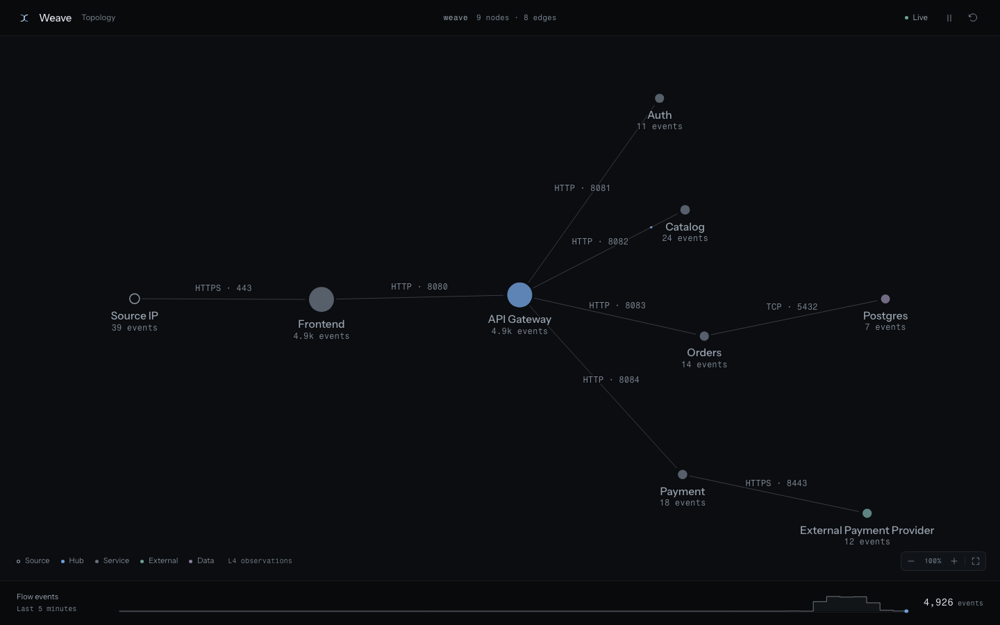
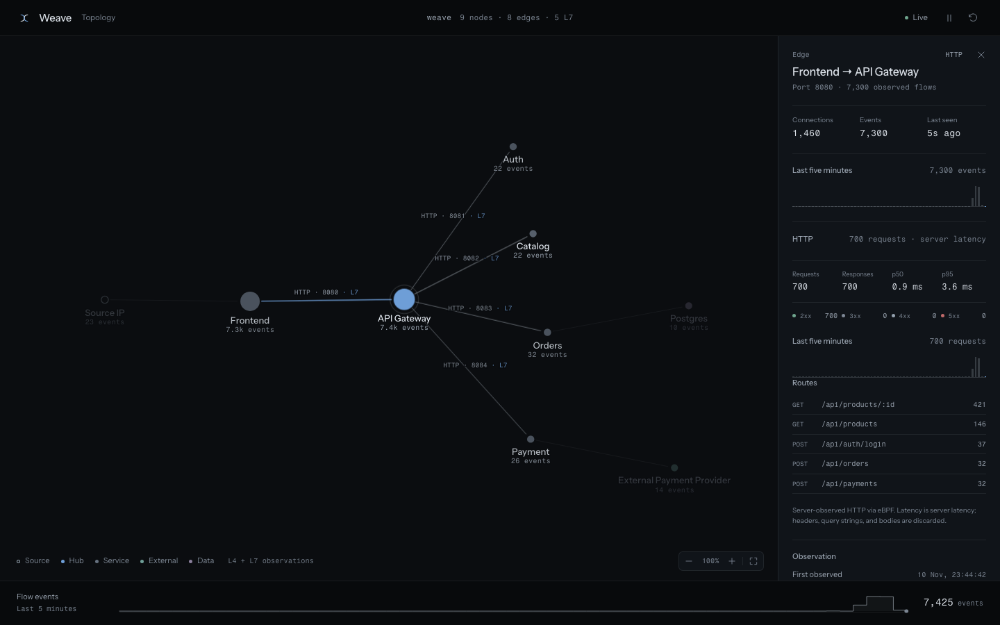

# Weave

Weave is a topology testbed and the observed topology app that accompanies it.
A dummy e-commerce **Target App** generates real HTTP traffic through a
**Simulator**; Weave follows Cilium Hubble L4 flows, consumes HTTP spans from
Grafana Beyla, and constructs a live workload-level map of what actually
crossed the network. Beyla uses eBPF and does not insert a proxy into
the Target App.

## What is here

- `services/app/` — the Target App: Vite frontend behind NGINX, API Gateway, Auth, Catalog, Orders (Postgres), Payment, and the External Payment Provider.
- `services/simulator/` — the CLI that runs the Bounce, Browse, and Order Journeys and writes a JSON report with the Expected Topology.
- `services/weave/` — the actual app: a Go topology constructor that follows Hubble Relay and serves a Vite/React operator screen.
- `compose.yaml` — local Docker Compose stack for the Target App.
- `deploy/` — Kubernetes: Helm charts for the Target App and Weave, kind cluster + Cilium bootstrap, Argo CD applications, per-environment values. See [deploy/README.md](deploy/README.md).
- `expected-topology.yaml` — the expected nodes and edges used by the inference benchmark.
- `scripts/integration-test.sh` — unit tests, frontend build, Compose, contract checks, and a short Simulator run.

## Requirements

- Docker with Compose
- Go 1.26+ for Weave; Go 1.24+ for the Target App and Simulator
- Node 20+ (for local frontend builds; Docker also builds the frontend)
- `kind`, `kubectl`, and `helm` for the in-cluster path, with Cilium/Hubble
  installed

## Run the Target App

```bash
docker compose up -d --build
docker compose ps
curl -k https://localhost:8443/health
```

Open <https://localhost:8443> and accept the self-signed certificate. Demo login: `user0001` / `password`.

The Frontend is the only published service. Everything else is internal to the Compose network:

| Service | Address | Notes |
|---|---|---|
| Frontend | `https://localhost:8443` | NGINX, TLS, SPA, `/api` proxy |
| Gateway | `gateway:8080` | routing and token validation |
| Auth | `auth:8081` | 2,000 in-memory accounts |
| Catalog | `catalog:8082` | 20 in-memory products |
| Orders | `orders:8083` | Postgres-backed |
| Payment | `payment:8084` | calls the External Payment Provider |
| External Payment Provider | `external:8443` | HTTPS, self-signed |
| Postgres | `postgres:5432` | `orders` database |

## Run Weave (kind + Hubble)

Weave runs in `weave-system` and watches the Target App in `weave`. It needs
the in-cluster Hubble Relay for L4 and a Beyla DaemonSet for HTTP L7; it does
not query the Kubernetes API. This path
assumes the Target App chart is installed in `weave` and Cilium has Hubble
enabled, as described in [deploy/README.md](deploy/README.md).

```bash
docker build -t weave-app:dev -f services/weave/Dockerfile services/weave
kind load docker-image weave-app:dev --name kind
helm upgrade --install weave deploy/charts/weave -n weave-system --create-namespace
kubectl -n weave-system rollout status deploy/weave --timeout=120s
kubectl -n weave-system port-forward svc/weave 8090:8080
```

Install the Beyla observer once Weave is reachable. It instruments only the
`gateway` process and sends OTLP traces to Weave; gateway client spans cover
the four downstream edges, and gateway server spans cover Frontend → Gateway:

```bash
helm repo add grafana https://grafana.github.io/helm-charts
helm repo update grafana
helm upgrade --install beyla grafana/beyla \
  --namespace beyla-system --create-namespace \
  --version 1.16.17 \
  -f deploy/platform/observability/beyla-values.yaml
```

Open <http://127.0.0.1:8090>. The screen is live; it will show an empty state
until Hubble reports a flow in `weave`.

To drive traffic, publish the Target App frontend and run the Simulator as
above:

```bash
kubectl -n weave port-forward svc/frontend 8443:8000
(cd services/simulator && go run ./cmd/sim run --config run.yaml)
```

Weave exposes:

| Endpoint | Purpose |
| --- | --- |
| `GET /api/topology` | Cumulative snapshot plus 60 activity buckets |
| `GET /api/stream` | SSE snapshots every second |
| `POST /api/reset` | Clear Weave's observed graph; not the Target App |
| `POST /v1/traces` | OTLP HTTP/protobuf receiver for Beyla |
| `GET /health` | Liveness and Relay status |

The graph shows **connections** (TCP opens) and **events** (observed L4 flows).
Edges that carry HTTP spans also show **requests**, **status classes**,
**p50/p95 with its latency source**, and **normalized routes**. L4 and L7 remain separate; they
are never summed. See [the Weave contract](docs/weave-contract.md),
[ADR-0003](docs/adr/0003-observed-topology.md), and
[ADR-0004](docs/adr/0004-l7-observability.md).





## Run the Simulator

The Simulator runs on the host, outside the Compose stack, so its traffic enters from the host IP.

```bash
cd services/simulator
go run ./cmd/sim validate --config run.yaml
go run ./cmd/sim run --config run.yaml --report ../../reports/run.json
```

That is the documented 10-minute, 50-user shape. The shorter `testdata/run-short.yaml` is used by the integration test. The Expected Topology path is relative to the working directory. `--log-requests` adds a per-request log to the report.

## Test

```bash
./scripts/integration-test.sh
```

The script runs the Go unit tests, the Vite build, `docker compose up --build`, HTTP contract checks, and a short Simulator run. It asserts that all three Journeys ran and that the Expected Topology has 9 nodes and 8 edges. Set `KEEP_STACK=1` to leave the stack running.

Weave's own tests:

```bash
(cd services/weave && go test ./...)
(cd services/weave/web && npm ci && npm run build)
./scripts/weave-integration-test.sh
```

The Weave integration script builds the image, deploys the chart, port-forwards
the app, runs the short Simulator config, and asserts that the constructed
graph is exactly 9 nodes and 8 edges, that the five HTTP edges carry L7
observations, and that the L4-only edges do not. It does not tear down the Target App;
the Simulator resets its own test data as part of the run.

Manual checks:

```bash
(cd services/app && go test ./...)
(cd services/simulator && go test ./...)
(cd services/app/frontend && npm ci && npm run build)
```

## Protocol and topology

- External: `Source IP → Frontend` HTTPS; `Payment → External Payment Provider` HTTPS.
- Internal: `Frontend → Gateway` HTTP; `Gateway → Auth/Catalog/Orders/Payment` HTTP; `Orders → Postgres` TCP.
- NGINX proxies `/api/*` and `/admin/reset` to the Gateway.
- The Simulator talks only to the Frontend. Source IP is the external boundary; through a local port-forward, Hubble reports the host endpoint. Weave displays the observed address, not a named `ext users` node.
- Weave groups pods into workloads, creates edges only from observed traffic, and folds replies into one ordered edge.
- L7 coverage is five of eight edges: `Frontend → Gateway` and
  `Gateway → Auth/Catalog/Orders/Payment`. `Source IP → Frontend` HTTPS,
  `Payment → External Payment Provider` HTTPS, and `Orders → Postgres` TCP stay
  L4-only.
- L7 requests, status, and latency come from Beyla gateway client and server
  spans. Four edges are client-observed; Frontend → Gateway is server-observed.
  The UI labels the source. Headers, query strings, and bodies are discarded.
- Kubelet probes from the host to non-Frontend workloads are excluded. The Source IP observed through a port-forward is the host endpoint; the inspector says so.
- The expected topology is in [expected-topology.yaml](expected-topology.yaml).

## Docs

- [Run spec](docs/run-spec.md)
- [Target App contract](docs/target-app-contract.md)
- [Weave topology contract](docs/weave-contract.md)
- [Glossary](GLOSSARY.md)
- [Product](PRODUCT.md)
- [Design](DESIGN.md)
- [ADR-0001: real traffic only](docs/adr/0001-real-traffic-only.md)
- [ADR-0002: HTTP client, not browser](docs/adr/0002-http-client-not-browser.md)
- [ADR-0003: observed topology](docs/adr/0003-observed-topology.md)
- [ADR-0004: L7 observability](docs/adr/0004-l7-observability.md)

## Not included

- Fault injection (container crash and saturation) — the next iteration.
- The Cilium L7 visibility policy. It was rejected because its Envoy proxy
  added a measurable latency regression; see ADR-0004.
- The benchmark comparison tool. The Simulator emits the ground truth; a
  separate tool compares it to Weave's `/api/topology`.
- A supported phone layout. Weave is designed for 1024px and wider.
