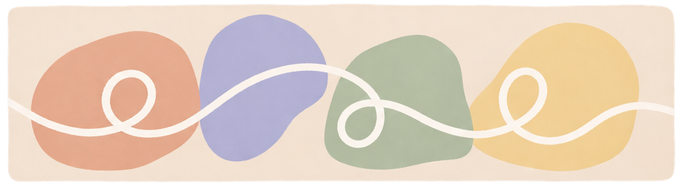
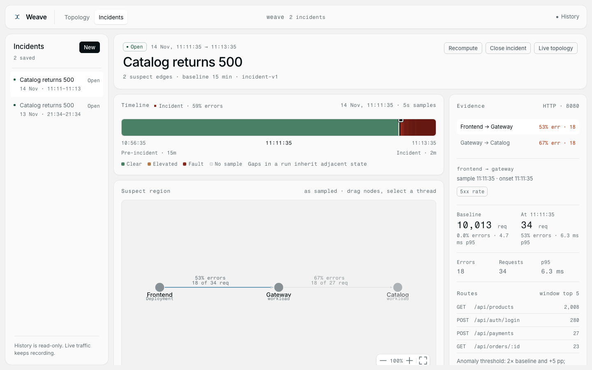
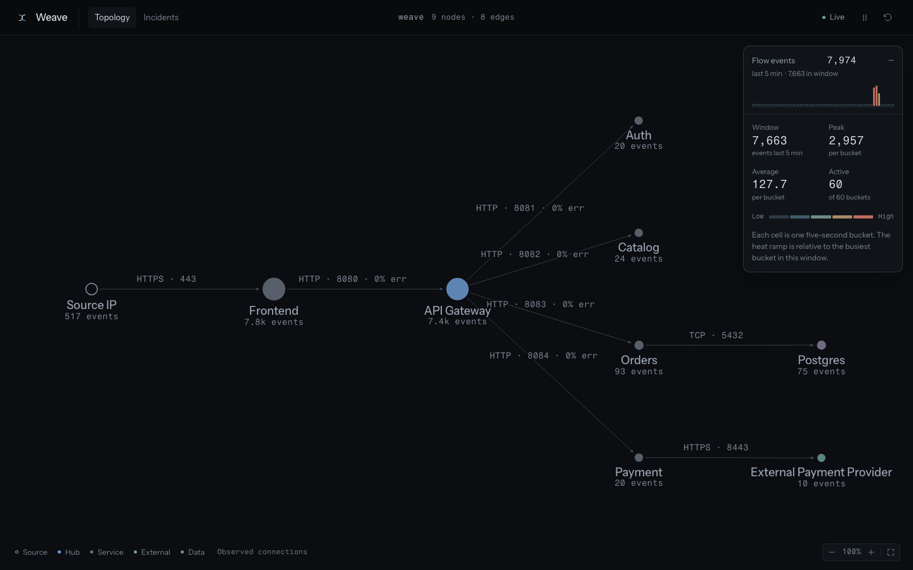

<p align="center">
   
</p>

<div align="center">
    <h1>Weave</h1>
    <h3><em>Observed topology. Retained history. A bounded suspect region, for AI investigators</em></h3>
</div>

<p align="center">
    <a href="LICENSE"></a>
    
    
    
    
    
</p>

<p align="center">
    <sub>Inspired by <a href="https://arxiv.org/abs/2512.22113">PRAXIS</a> (graph traversal for agentic diagnosis, DSN 2026) and <a href="https://arxiv.org/abs/2604.06448">Prime Video's graph-embedding anomaly detection</a> (FSE 2026). See <a href="#references">References</a>.</sub>
</p>

Weave is an incident-replay topology app for a Kubernetes application. It
constructs an observed workload graph from Cilium Hubble L4 flows and Grafana
Beyla HTTP spans, retains a time-bucketed history, reads the Argo CD desired
inventory read-only, and turns a manually selected incident window into a
bounded suspect region.


## Choose your path

| What you need | Start at | Outcome |
| --- | --- | --- |
| See Weave running | [Run Weave](#run-weave) | Four services in `weave-system`, UI on `:8090` |
| Reproduce an incident | [Incident replay acceptance](#incident-replay-acceptance) | 20-minute replay with a verified suspect region |
| Change Weave | [Developing with Spec Kit](#developing-with-spec-kit) | A spec carried through plan, tasks, and implementation |
| Understand the design | [Docs](#docs) | ADRs, contracts, glossary |

## What is here

- `services/app/` — the Target App: Vite frontend behind NGINX, API Gateway, Auth, Catalog, Orders (Postgres), Payment, and the External Payment Provider.
- `services/simulator/` — the CLI that runs Bounce, Browse, and Order Journeys and writes a JSON report with the Expected Topology.
- `services/weave/` — the app, split into four Go services: `weave-live`, `weave-history`, `weave-inventory`, and `weave-api` (the operator screen and single browser origin).
- `compose.yaml` — local Docker Compose stack for the Target App.
- `deploy/` — Kubernetes: Helm charts, kind + Cilium bootstrap, Argo CD, Chaos Mesh, and Beyla. See [deploy/README.md](deploy/README.md).
- `expected-topology.yaml` — the healthy fixture's expected nodes and edges.
- `scripts/integration-test.sh` — unit tests, frontend build, Compose, contract checks, and a short Simulator run.
- `scripts/incident-replay.sh` — the 20-minute acceptance harness: 15-minute baseline, 2-minute Catalog fault, 3-minute recovery, then incident creation.
- `scripts/weave-up.sh` — build, kind-load, and install the four-service Weave stack, then port-forward the UI.
- `scripts/weave-degradation-test.sh` — verify that a history or inventory outage degrades only its own panels.
- `docs/adr/0005-incident-replay.md` — the incident-replay architecture.
- `docs/adr/0006-weave-service-decomposition.md` — the four-service architecture and its contracts.
- `docs/acceptance.md` — the recorded acceptance runs and their evidence.

## Requirements

- Docker with Compose.
- Go 1.26+ for Weave; Go 1.24+ for the Target App and Simulator.
- Node 20+ for local frontend builds. The Weave image builds the frontend itself.
- `kind`, `kubectl`, and `helm` for the in-cluster path, with Cilium/Hubble,
  Argo CD, Chaos Mesh, and Beyla installed.

Only `weave-history` needs CGO because DuckDB is embedded there. Every service
image is a Debian build and runtime, not a static Alpine binary.

## Run the Target App

```bash
docker compose up -d --build
docker compose ps
curl -k https://localhost:8443/health
```

Open <https://localhost:8443> and accept the self-signed certificate. Demo login:
`user0001` / `password`.

| Service | Address | Notes |
|---|---|---|
| Frontend | `https://localhost:8443` | NGINX, TLS, SPA, `/api` proxy |
| Gateway | `gateway:8080` | routing and token validation |
| Auth | `auth:8081` | 2,000 in-memory accounts |
| Catalog | `catalog:8082` | 20 in-memory products |
| Orders | `orders:8083` | Postgres-backed |
| Payment | `payment:8084` | calls the External Payment Provider |
| External Payment Provider | `external:8443` | HTTPS, self-signed |
| Postgres | `postgres:5432` | `orders` database |

## Run Weave

Weave runs as four services in `weave-system` and watches the Target App in
`weave`. [ADR-0006](docs/adr/0006-weave-service-decomposition.md) records the
split, the data ownership, and the internal contracts.

| Service | Role | State |
| --- | --- | --- |
| `weave-live` | Hubble and Beyla ingest, observed graph, snapshot/SSE/reset, observation feed | in memory |
| `weave-history` | DuckDB metrics, incidents, evidence, timeline, recording gaps | `weave-data` PVC |
| `weave-inventory` | Argo declared workloads, lifecycle, change events | `weave-inventory-data` PVC |
| `weave-api` | The built UI and the single browser origin; proxies the frozen `/api/*` contract | none |

`weave-live` follows Hubble Relay and accepts Beyla's OTLP traces. `weave-history`
owns both embedded databases. `weave-inventory` is the only service that reads
the Argo CD application `target-app-local`, through a read-only API token. No
service calls the Kubernetes API.

```bash
./scripts/weave-up.sh
```

That builds and kind-loads the four images, installs the umbrella chart, waits
for all deployments, and port-forwards `svc/weave-api` to 8090. For the manual
steps see [deploy/README.md](deploy/README.md).

`weave-history` and `weave-inventory` are the only stateful services: one replica
each, `Recreate`, on its own ReadWriteOnce PVC. The history subchart reuses an
existing `weave-data` volume, so recorded incidents survive the migration from
the single-process deployment. `persistence.accessMode` is configurable per
subchart; use `ReadWriteOncePod` where the storage class supports it.

Create the read-only Argo token before Weave starts. Without it `weave-inventory`
records observed workloads but cannot reconcile declared/live lifecycle states.
The exact commands are in
[deploy/platform/argocd/README.md](deploy/platform/argocd/README.md).

Beyla is a separate platform addon:

```bash
helm repo add grafana https://grafana.github.io/helm-charts
helm repo update grafana
helm upgrade --install beyla grafana/beyla \
  --namespace beyla-system --create-namespace \
  --version 1.16.17 \
  -f deploy/platform/observability/beyla-values.yaml
```

Beyla instruments only the `gateway` process and exports to `weave-live`. Gateway
client spans cover Gateway → Auth/Catalog/Orders/Payment; gateway server spans
cover Frontend → Gateway. It is a privileged eBPF DaemonSet and inserts no proxy.

Open <http://127.0.0.1:8090>. The live topology starts empty; drive traffic with
the Simulator after port-forwarding the Target App frontend:

```bash
kubectl -n weave port-forward svc/frontend 8443:8000
(cd services/simulator && go run ./cmd/sim run --config run.yaml)
```

### Weave API

`weave-api` serves the browser contract and proxies each path to its owner. The
paths and payloads are unchanged from the single-process release.

| Endpoint | Owner | Purpose |
| --- | --- | --- |
| `GET /api/topology` | `weave-live` | Live cumulative snapshot plus 60 activity buckets |
| `GET /api/stream` | `weave-live` | SSE topology snapshots every second |
| `POST /api/reset` | `weave-live` | Clear Weave's live graph; not the Target App |
| `POST /v1/traces` | `weave-live` | OTLP HTTP/protobuf receiver for Beyla; called directly, not proxied |
| `POST /api/incidents` | `weave-history` | Create and materialize an incident window |
| `GET /api/incidents` | `weave-history` | List incidents |
| `GET /api/incidents/{id}` | `weave-history` | Incident with its evidence snapshot |
| `PATCH /api/incidents/{id}` | `weave-history` | Update notes or open/closed state |
| `POST /api/incidents/{id}/recompute` | `weave-history` | Recompute evidence for the stored window |
| `GET /api/incidents/{id}/timeline` | `weave-history` | Suspect-edge frames plus recording gaps |
| `GET /api/changes?from=&to=` | `weave-inventory` | Lifecycle change events |
| `GET /health`, `/api/health` | `weave-api` | Local health plus aggregated dependency status |

Seeded history: 5-second edge buckets for 24 hours, 1-minute rollups for 7 days,
and change events for 30 days. Raw flows and spans are never retained. Recording
gaps are explicit: a history outage is not zero traffic. See
[the Weave contract](docs/weave-contract.md) and
[the internal service contract](docs/weave-internal-api.md).

### Incident view

The `Topology` / `Incidents` switch opens the incident workspace. An incident
has a 15-minute baseline, a scrub timeline that starts with that baseline and
marks the transition into the incident window, a suspect-region canvas, per-edge
baseline/incident evidence, lifecycle changes, notes, close/reopen, and a live
topology link. The incident graph labels show error rates and quantities, not
protocol labels.

The flow heatmap at the top right of the topology view expands to the window
total, peak bucket, average, and active buckets. It is a live five-minute
instrument, not history.






## Developing with Spec Kit

Weave uses [GitHub Spec Kit](https://github.com/github/spec-kit) for
Spec-Driven Development. The toolkit is installed in this repository under
`.dsh/skills/` (nine `/speckit-*` skills) and `.specify/` (templates, scripts,
constitution).

The skills are invoked in the agent chat, not the shell, one at a time, and you
review each artifact before continuing:

```text
/speckit-constitution   Establish or update project principles
/speckit-specify        Turn a feature description into a specification
/speckit-clarify        Ask targeted questions before planning (optional)
/speckit-plan           Produce the implementation plan
/speckit-tasks          Generate dependency-ordered tasks
/speckit-analyze        Check spec, plan, and tasks for consistency (optional)
/speckit-implement      Execute the tasks
/speckit-converge       Find unbuilt work and append it to the tasks
```

Repeat `implement` and `converge` until convergence reports `Converged`.

`.specify/memory/constitution.md` is the project's ground rules. Weave has
non-obvious rules that a plan can silently violate, so keep them in the
constitution:

- Nodes and edges exist only because traffic was observed. Declared
  architecture never creates an observed edge.
- L4 connections/events and L7 requests are never summed.
- `latency_source` is `client`, `server`, or `mixed`, and is exposed per edge.
- A recording gap is missing data, not zero traffic.
- The output is a suspect region, never a single root cause.

Reinstalling or upgrading the toolkit:

```bash
uv tool install specify-cli
specify self check
```

## Incident replay acceptance

The 20-minute replay is:

1. 15 minutes of healthy traffic.
2. Chaos Mesh `HTTPChaos` replacing Catalog `GET /api/products` with HTTP 500 for two minutes.
3. Three minutes of recovery.
4. An Incident created over the fault window.

```bash
./scripts/incident-replay.sh
```

The script expects the Target App port-forward on `:8443` and the Weave API/BFF on `:8090` (`svc/weave-api`).
It applies `deploy/platform/chaos/fixtures/catalog-http-500.yaml` at the
15-minute mark, removes it after two minutes, waits for the three-minute
recovery, and creates the incident through `POST /api/incidents`.

The expected result is a suspect region containing Catalog and
Gateway → Catalog, with Frontend → Gateway as the cascade. Auth and Payment must
be outside it. **The 2026-11-14 acceptance passed on both the single-process and
the four-service deployments.** On the four-service run the suspect edges were
Frontend → Gateway and Gateway → Catalog with first-bucket onsets, Auth, Orders,
and Payment were outside, the timeline had 205 frames and no Recording Gap in
the incident context, and the incident survived a history/inventory restart with
identical JSON. The recorded evidence and hashes are in
[docs/acceptance.md](docs/acceptance.md).

## Run the Simulator

The Simulator runs on the host, outside the Compose stack, so its traffic enters
from the host IP.

```bash
cd services/simulator
go run ./cmd/sim validate --config run.yaml
go run ./cmd/sim run --config run.yaml --report ../../reports/run.json
```

The default is the 10-minute, 50-user healthy Run. `testdata/run-short.yaml` is
the integration smoke run. `testdata/incident-replay.yaml` is the 20-minute
acceptance shape. The Expected Topology path is relative to the working
directory. `--log-requests` adds per-request details to the report.

## Test

```bash
./scripts/integration-test.sh
```

Weave's own checks:

```bash
(cd services/weave && go test ./...)
(cd services/weave/web && npm ci && npm run build)
./scripts/weave-integration-test.sh
./scripts/weave-degradation-test.sh
```

The integration script also asserts the service import boundaries, so no service
package can start importing another service's internals.

Manual:

```bash
(cd services/app && go test ./...)
(cd services/simulator && go test ./...)
(cd services/app/frontend && npm ci && npm run build)
```

## Protocol and topology

- External: `Source IP → Frontend` HTTPS; `Payment → External Payment Provider` HTTPS.
- Internal: `Frontend → Gateway` HTTP; `Gateway → Auth/Catalog/Orders/Payment` HTTP; `Orders → Postgres` TCP.
- Weave groups pods into workloads, creates edges only from observed traffic, and folds replies into one ordered request edge.
- HTTP coverage is five of eight edges. `Source IP → Frontend` HTTPS,
  `Payment → External Payment Provider` HTTPS, and `Orders → Postgres` TCP are
  connection-level only.
- Four HTTP edges are client-observed; Frontend → Gateway is server-observed.
  The inspector labels the latency source per edge. Headers, query strings, and
  bodies are discarded.
- Kubelet probes are excluded by the observed-topology filter. The Source IP
  seen through a port-forward is the host endpoint.
- Declared Architecture is Argo CD object inventory only. It never creates an
  observed edge.
- The expected healthy topology is [expected-topology.yaml](expected-topology.yaml).

## Docs

- [Run spec](docs/run-spec.md)
- [Target App contract](docs/target-app-contract.md)
- [Weave contract](docs/weave-contract.md)
- [Weave internal service contract](docs/weave-internal-api.md)
- [Acceptance](docs/acceptance.md)
- [Glossary](GLOSSARY.md)
- [Product](PRODUCT.md)
- [Design](DESIGN.md)
- [ADR-0001: real traffic only](docs/adr/0001-real-traffic-only.md)
- [ADR-0002: HTTP client, not browser](docs/adr/0002-http-client-not-browser.md)
- [ADR-0003: observed topology](docs/adr/0003-observed-topology.md)
- [ADR-0004: L7 observability](docs/adr/0004-l7-observability.md)
- [ADR-0005: incident replay](docs/adr/0005-incident-replay.md)
- [ADR-0006: service decomposition](docs/adr/0006-weave-service-decomposition.md)

## References

Two papers shaped Weave's design.

**Graph traversal for agentic diagnosis.** Weave's premise that an agent should
navigate an explicit graph — service dependencies at one level, code at another
— rather than search logs blindly comes from this work:

> Shengkun Cui, Rahul Krishna, Saurabh Jha, and Ravishankar K. Iyer.
> *PRAXIS: Integrating Program Analysis with Observability for Root-Cause
> Analysis.* arXiv:2512.22113, 2026. Accepted to appear in the 56th Annual
> IEEE/IFIP International Conference on Dependable Systems and Networks (DSN).
> [arXiv:2512.22113](https://arxiv.org/abs/2512.22113) ·
> [doi:10.1109/DSN69566.2026.00021](https://doi.org/10.1109/DSN69566.2026.00021)

PRAXIS models architecture and code as two linked graphs — a service dependency
graph and a hammock-block program dependence graph — and drives an LLM agent
through a structured traversal of them. Weave takes the traversal idea and stops
at the service layer: the observed graph is the whole surface, and the suspect
region is the output rather than a code-level root cause.

**Architecture snapshots as an incident signal.** Weave's bundled 5-second edge
metrics and its incident timeline come from this work:

> Srinidhi Madabhushi, Pranesh Vyas, Swathi Vaidyanathan, Mayur Kurup,
> Elliott Nash, and Yegor Silyutin. *From Load Tests to Live Streams: Graph
> Embedding-Based Anomaly Detection in Microservice Architectures.*
> arXiv:2604.06448, 2026. Accepted at FSE 2026 — Industrial Track.
> [arXiv:2604.06448](https://arxiv.org/abs/2604.06448) ·
> [Amazon Science](https://www.amazon.science/publications/from-load-tests-to-live-streams-graph-embedding-based-anomaly-detection-in-microservice-architectures)

The Prime Video team takes directed, weighted service graphs at minute-level
resolution and learns node embeddings so that a live event can be compared
against a load-test baseline. Weave keeps the snapshot cadence and the
baseline-versus-window comparison, and uses a deterministic threshold rather
than an embedding model: no training data, and every flagged edge is
explainable in the evidence snapshot.

## Not included

- Authentication. The API is internal and port-forward only.
- An Agent UI. The read API is shared with a future Agent.
- Architecture/telemetry evolution beyond stored metrics and change events.
- A statistical single-root-cause claim. The output is a suspect region.
- Historical full-topology reconstruction at `at=...`; the incident timeline is
  built from suspect-edge metric frames, and `Live topology` opens the current
  graph.
- A supported phone layout. The visual layout holds at 720px, but the operator
  layout is designed for 1024px and wider.
- Generic all-connection host/probe acceptance. The current live filter keeps
  the Target App's ingress-scoped host behavior and fixture display names; the
  incident acceptance region is unaffected.
