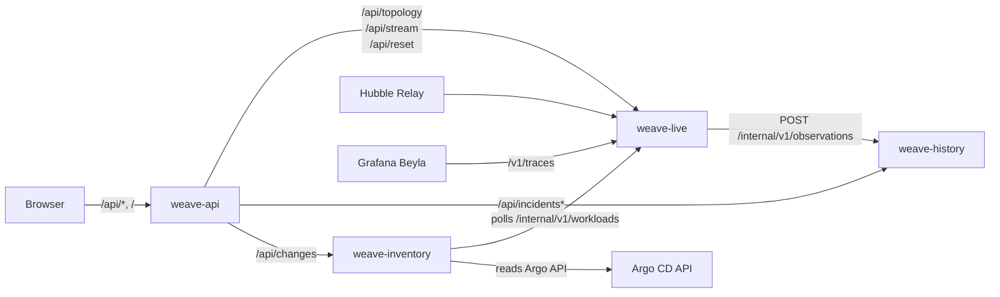

# Weave internal service contract

- **Status:** Implemented 2026-11-14; design accepted in ADR-0006
- **Scope:** traffic between the four Weave services

[ADR-0006](adr/0006-weave-service-decomposition.md) splits Weave into four
services. The external contract in [`weave-contract.md`](weave-contract.md) is
unchanged: the browser and any future Agent still see one origin and the same
paths. This document defines only the cluster-internal contracts between the
services.

## Service map



## Route ownership

`weave-api` proxies each external path to the owning service; no other service
serves a browser path.

| External path | Owner | Notes |
| --- | --- | --- |
| `GET /api/topology` | `weave-live` | In-memory snapshot |
| `GET /api/stream` | `weave-live` | SSE, one snapshot per second per client |
| `POST /api/reset` | `weave-live` | Clears the live graph only |
| `POST /v1/traces` | `weave-live` | Called directly by Beyla, not proxied |
| `POST /api/incidents` | `weave-history` | Materializes evidence |
| `GET /api/incidents`, `GET /api/incidents/{id}` | `weave-history` | |
| `PATCH /api/incidents/{id}` | `weave-history` | Notes and open/closed |
| `POST /api/incidents/{id}/recompute` | `weave-history` | |
| `GET /api/incidents/{id}/timeline` | `weave-history` | |
| `GET /api/incidents/{id}/alerts` | `weave-history` | Alerts grouped into the incident |
| `GET /api/metrics/edges` | `weave-history` | Edge metric range query |
| `GET /api/metrics/routes` | `weave-history` | Route metric range query |
| `GET /api/changes` | `weave-inventory` | |
| `GET /health`, `GET /api/health` | `weave-api` | Aggregates dependency health |
| `GET /` and SPA fallback | `weave-api` | Built UI assets baked into the image |

## Common rules

- HTTP + JSON over Kubernetes Service DNS. Cluster-internal only; no auth, no
  TLS, no broker. The BFF never proxies `/internal/v1`.
- Timestamps are RFC3339 UTC with milliseconds. Bucket membership uses the
  **event time** carried from the observation, never receipt time.
- `weave-live` is the only producer of observations and the only authority on
  what was observed. `weave-history` is the only owner of bucket semantics,
  edge IDs, and path normalization.
- Paths are versioned (`/internal/v1`). Changes are additive until a new
  version exists; no field is renamed or removed within a version.
- The DTOs live in one shared Go package (`internal/contracts`) so producer and
  consumer compile against the same shape. Contract tests exercise both ends
  over HTTP.

## Observation feed

`weave-live` → `weave-history`, `POST /internal/v1/observations`.

### Batching

`weave-live` buffers accepted, deduplicated observations and flushes every
second, or sooner at 500 observations. A batch is one request. Ordering between
batches is not required.

```json
{
  "epoch": "2026-11-14T18:00:00.000Z",
  "seq": 1841,
  "l4": [
    {
      "source": "frontend",
      "target": "gateway",
      "protocol": "TCP",
      "port": 8080,
      "connection": true,
      "time": "2026-11-14T18:00:01.234Z"
    }
  ],
  "l7": [
    {
      "source": "gateway",
      "target": "catalog",
      "port": 8082,
      "method": "GET",
      "path": "/api/products/42/reviews",
      "status": 500,
      "latency_source": "client",
      "duration_ms": 12.4,
      "time": "2026-11-14T18:00:01.240Z"
    }
  ],
  "gaps": []
}
```

- `source`, `target`: observed workload names in `WATCH_NAMESPACE`. The
  aggregate `Source IP` boundary is never sent here; it is presentation only.
- `l4.connection`: true for a new connection, false for a repeated event, so
  `weave-history` can count connections and events separately.
- `l7.path` is the raw path; `weave-history` applies the same normalization as
  before and stores only method, normalized route, status, duration, latency
  source, and time. No headers, query strings, or bodies cross the boundary.
- `epoch` is the `weave-live` instance start time; `seq` increases monotonically
  within an epoch. `weave-history` ignores a batch whose `seq` is not greater
  than the last applied value for that epoch (defense against accidental
  double-send; not a replay mechanism).
- Maximum payload: 4 MiB, 500 observations.

### Delivery guarantee

At-most-once. `weave-live` does not retry a failed POST and does not keep a
replay buffer: an HTTP error, timeout, or non-2xx response drops the batch, and
the drop is counted as a Recording Gap. This keeps ingest independent of
`weave-history` and keeps the failure visible instead of hiding it.

`weave-history` responds:

| Status | Meaning |
| --- | --- |
| `202 Accepted` | Batch applied to in-memory buckets |
| `400 Bad Request` | Malformed payload; producer drops it |
| `413 Payload Too Large` | Producer must split its batches |
| `503 Service Unavailable` | Database unavailable; producer drops and records a gap |

### Late observations and the flush grace

`weave-history` flushes a bucket to DuckDB only after `bucket_start + bucket +
15 s`. Observations inside the grace window merge into the pending bucket;
observations older than the grace window are dropped and counted
(`late_observations`). Without the grace, a late observation would reopen a
flushed bucket and `INSERT OR REPLACE` would overwrite the complete row with
partial counts.

The 15-second lag applies only to persisted history; the live topology is
served by `weave-live` from memory at one-second cadence. Incident, evidence,
and timeline queries read minutes of history, so the lag is not observable
there.

## Observed-workload feed

`weave-inventory` → `weave-live`, `GET /internal/v1/workloads`, polled at the
start of each 30-second reconcile (the same cadence as the Argo read).

```json
{
  "workloads": [
    {
      "workload": "catalog",
      "kind": "Deployment",
      "first_seen": "2026-11-14T17:01:12.000Z",
      "last_seen": "2026-11-14T18:00:03.500Z"
    }
  ]
}
```

- Excludes the `Source IP` boundary and workloads with no qualifying traffic.
- If `weave-live` is unreachable or times out (1 s), `weave-inventory` skips
  that reconcile and keeps serving stored state and change events — the same
  failure handling it already applies to an Argo error.

## Recording gaps

A **Recording Gap** is a known interval in which `weave-live` observed traffic
but could not deliver it to `weave-history`. It is not zero traffic.

- `weave-live` tracks consecutive failed batches. When delivery resumes, it
  includes the interval in the next batch's `gaps` array:
  `{"from": "...", "to": "..."}`.
- `weave-history` persists gap intervals in SQLite and includes them in
  `/api/incidents/{id}/timeline` as an additive top-level `gaps` array. The
  existing `window`, `context`, `bucket_seconds`, `suspect_edges`, and `frames`
  fields are unchanged.
- `/api/health` reports whether a gap is in progress, the number of gaps,
  and the dropped-observation count. The UI can then show "no recording"
  distinctly from "no traffic".
- Evidence thresholds are unchanged: a gap is evidence about the instrument,
  not about the Target App.

## Health and failure

Every service exposes `GET /health` for its own probes and `GET /api/health`
only on `weave-api` for scripts and the UI.

Local `/health` responses keep the existing top-level fields where they apply:
`{"status":"ok","hubble_connected":true,"observed_flows":7439}` on
`weave-live`, and `{"status":"ok"}` plus service-specific counters elsewhere.
Each probe checks only its own process; no readiness depends on another service.

`weave-api` aggregates with a short timeout (1 s) and adds an additive
`dependencies` object:

```json
{
  "status": "degraded",
  "hubble_connected": true,
  "observed_flows": 7439,
  "recording_gaps": 1,
  "dropped_observations": 1841,
  "dependencies": {
    "live": "ok",
    "history": "unavailable",
    "inventory": "ok"
  }
}
```

`hubble_connected` and `observed_flows` are copied from `weave-live`; `status`
is `degraded` when any dependency is unavailable. Existing consumers that only
read the old fields keep working.

| Down | Browser behavior | Health |
| --- | --- | --- |
| `weave-live` | Topology and heatmap unavailable; incidents still readable | API `degraded`; history keeps serving stored data |
| `weave-history` | Incident tab unavailable; topology keeps running | API `degraded`; live reports a gap once delivery resumes |
| `weave-inventory` | Changes section unavailable; incidents unaffected | API `degraded`; stored change events still served |
| `weave-api` | Whole UI unavailable | Direct service health still reachable in-cluster |

The BFF keeps no cache: a panel shows an explicit unavailable state and a
retry, never stale data presented as current.

## Contract discipline

- Both internal endpoints have contract tests that run the producer handler and
  consumer client against the shared DTOs.
- A Go test asserts package direction: `live` does not import `history` or
  `inventory`; no service imports another service's store.
- The migration path and verification bar are in
  [ADR-0006](adr/0006-weave-service-decomposition.md). The external contract in
  [`weave-contract.md`](weave-contract.md) remains authoritative for browser and
  Agent consumers; additive fields listed here are the only planned change.
